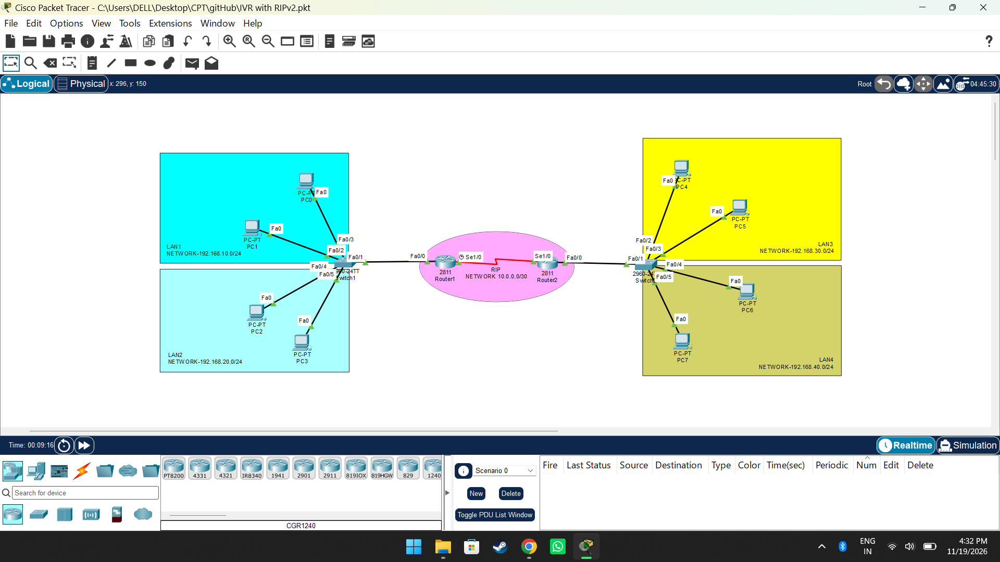

# IVR-with-RIPv2-packet-tracer
Cisco Packet Tracer lab: router-on-a-stick inter-VLAN routing on two sites, connected by a serial link running RIPv2.
# Inter-VLAN Routing (Router-on-a-Stick) with RIPv2 (Cisco Packet Tracer)

## Overview
This project connects two sites over a serial link. At each site, a switch carries two VLANs over a single trunk link to the router, and the router performs **inter-VLAN routing** using subinterfaces (router-on-a-stick). **RIP version 2** shares the routes between the two routers, so PCs in all four LANs can reach each other.

## Topology


## Network Design

| Site | LAN | Network | Devices |
|------|-----|---------|---------|
| Site 1 (Router1) | LAN1 (VLAN 10) | 192.168.10.0/24 | PC0, PC1 |
| Site 1 (Router1) | LAN2 (VLAN 20) | 192.168.20.0/24 | PC2, PC3 |
| Site 2 (Router2) | LAN3 (VLAN 30) | 192.168.30.0/24 | PC4, PC5 |
| Site 2 (Router2) | LAN4 (VLAN 40) | 192.168.40.0/24 | PC6, PC7 |
| WAN link | Serial | 10.0.0.0/30 | Router1 Se1/0 to Router2 Se1/0 |

- **Switch1 and Switch2** are 2960 switches with VLANs configured and a trunk port toward the router.
- **Router1 and Router2** (2811) each have subinterfaces on Fa0/0, one per VLAN, acting as the default gateway.
- **RIPv2** runs on both routers to advertise the LANs and the WAN link.

## Technologies Used
- VLANs and 802.1Q trunking
- Inter-VLAN routing (router-on-a-stick with subinterfaces)
- RIP version 2
- Serial point-to-point link
- IP addressing and subnetting
- Cisco 2811 routers and 2960 switches

## Objectives
- Create VLANs and assign access ports on both switches
- Configure a trunk between each switch and its router
- Configure subinterfaces with 802.1Q encapsulation as the VLAN gateways
- Configure RIPv2 between the two routers
- Verify connectivity between PCs in different VLANs and across sites

## Verification
- `show vlan brief` to check VLANs and port assignments
- `show interfaces trunk` to confirm the trunk
- `show ip interface brief` to check subinterfaces
- `show ip route` to see connected and RIP (R) routes
- `show ip protocols` to confirm RIP version 2
- Ping between PCs in different VLANs at the same site, and between sites (for example PC0 to PC6)

## Sample Configuration
```
! Switch
vlan 10
vlan 20
interface fa0/1
 switchport mode trunk

! Router1 (router-on-a-stick)
interface fa0/0
 no shutdown
interface fa0/0.10
 encapsulation dot1Q 10
 ip address 192.168.10.254 255.255.255.0
interface fa0/0.20
 encapsulation dot1Q 20
 ip address 192.168.20.254 255.255.255.0

! RIPv2
router rip
 version 2
 network 192.168.10.0
 network 192.168.20.0
 network 10.0.0.0
 no auto-summary
```

## How to Open
Download the `.pkt` file (or the zip) and open it in Cisco Packet Tracer.

## Result
PCs in different VLANs communicate through the router subinterfaces, and RIPv2 allows all four LANs across both sites to reach each other.
